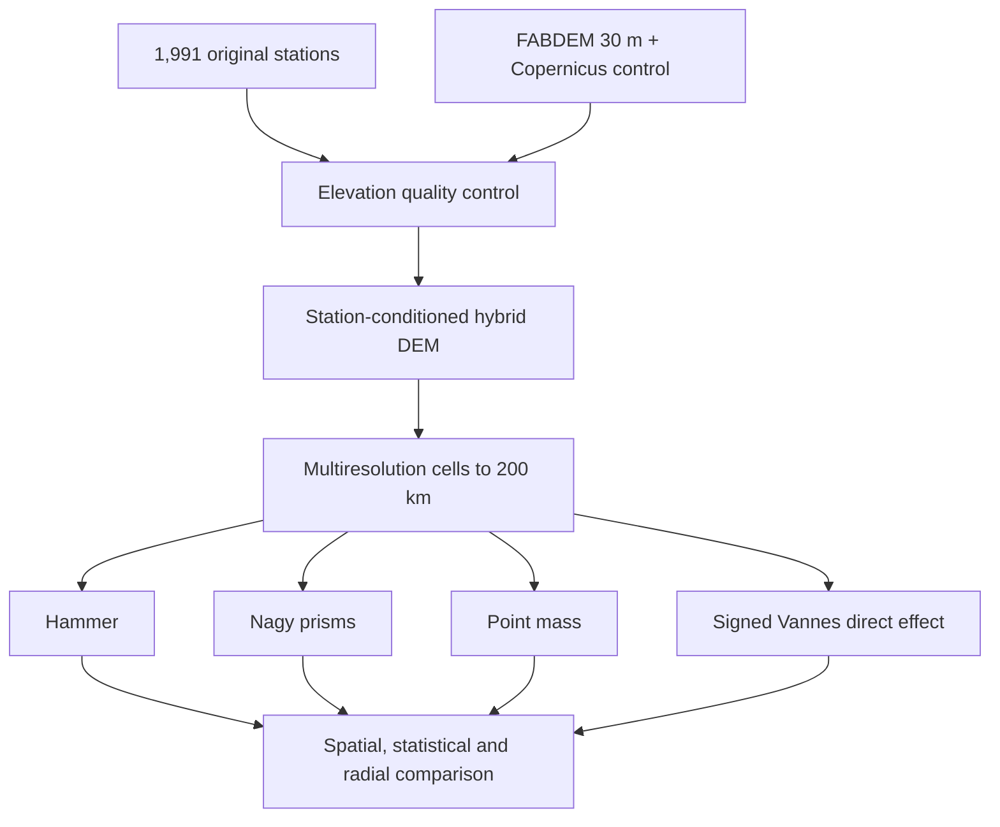

# Terrain correction of gravity anomalies in Cameroon

This repository implements a reproducible comparison of terrain-effect methods
for **1,991 original gravity stations** in Cameroon. The observation coordinates,
station elevations and free-air anomalies come from
`data/raw/original_stations.xlsx`. The terrain is represented by a
**station-conditioned FABDEM hybrid DEM**, not by the former Surfer interpolation.

## Scientific question

The project separates two sources of variation that are often conflated:

1. the terrain model used to describe the surrounding masses;
2. the numerical/geometrical method used to compute their gravity effect.

Every method therefore uses the same density, station elevations, hybrid terrain,
radial domain and multiresolution cells. Four estimates are produced:

| Output | Meaning |
|---|---|
| `nagy_prism_mgal` | classical positive terrain correction from exact rectangular prisms |
| `hammer_mgal` | Hammer-style annular-sector approximation of the same classical correction |
| `point_mass_mgal` | cell-centroid approximation used as a convergence diagnostic |
| `vannes_direct_mgal` | signed spherical residual direct effect transcribed from Vannes (2011) |

The Vannes value is not silently treated as identical to the conventional
positive terrain correction. Its definition and sign are preserved in the
outputs so the comparison remains physically interpretable.

## Input inventory

The workbook audit is fixed by tests:

- 1,991 measurements;
- 1,979 unique coordinate pairs;
- 12 repeated coordinates;
- 147 station altitudes equal to 0 m;
- extent: 8.5020-10.9933 deg E and 3.5006-6.5000 deg N;
- altitude range: 0-2,258 m.

Raw measurements are never overwritten. Quality-control decisions are stored
separately in `data/processed/hybrid_dem/excluded_controls.json`.

## Why the hybrid DEM is used

The former `out1.dat` grid was kriged from the same station elevations. Its
small station residuals therefore measure interpolation fidelity, not independent
terrain accuracy. It also has a spacing of roughly 0.5 km and smooths ridges,
valleys and steep slopes.

The hybrid model keeps the 1 arc-second morphology of FABDEM v1.2 and adds only a
smooth, robust correction inferred from reliable station-minus-FABDEM residuals:

```text
h_hybrid(x, y) = h_FABDEM(x, y) + w(x, y) r_hat(x, y)
```

Its construction, exclusions, cross-validation and limitations are documented
in [docs/hybrid_dem_method.md](docs/hybrid_dem_method.md). The principal spatial
block-validation result is:

| Metric | FABDEM | Hybrid DEM |
|---|---:|---:|
| Bias (m) | +1.673 | -0.052 |
| MAE (m) | 15.668 | 15.441 |
| RMSE (m) | 26.018 | 25.360 |
| 95th percentile absolute error (m) | 58.508 | 57.294 |

The improvement is modest but independent of the held-out spatial blocks. The
hybrid model is retained mainly because it removes the regional bias while
preserving satellite-derived terrain morphology.

## Processing and comparison scheme



## Main maps and comparison plots

### Study area, hybrid terrain and stations


### Former Surfer grid, hybrid DEM and spatial difference


### Independent hybrid-DEM validation


### Station-by-station method comparison at 200 km


### Radial convergence


### Elevation quality-control map


See the [annotated visual atlas](docs/visual_results.md) for interpretation.
All figures are reproducibly generated by `scripts/make_visual_atlas.py`.

## Reproduce on Windows 10 with Anaconda

Open **Anaconda Prompt**:

```powershell
git clone https://github.com/ariel2000/terrain-correction-gravity.git
cd terrain-correction-gravity
conda create -n terrain-gravity python=3.12 -y
conda activate terrain-gravity
python -m pip install -e ".[dev]"
pytest
terrain-correction audit-stations data/raw/original_stations.xlsx
```

Download FABDEM and Copernicus tiles according to
`data/external/README.md`, then reconstruct or copy the twelve hybrid tiles.
Run every station and convergence radius with:

```powershell
terrain-correction run --config config/default.toml
```

The command writes one row per station and radius to
`outputs/runtime/terrain_corrections.csv` and flushes every completed row, so a
long calculation can be inspected while it is running.

## Multiresolution integration

The default calculation is not truncated; it reaches 200 km. It uses mean-height
aggregation to preserve cell volume while controlling cost:

| Radial interval | DEM cell size |
|---:|---:|
| 0-0.5 km | 1 arc-second (~30 m) |
| 0.5-2 km | 3 arc-seconds (~90 m) |
| 2-20 km | 15 arc-seconds (~450 m) |
| 20-200 km | 60 arc-seconds (~1.8 km) |

Convergence is evaluated at 20, 50, 100 and 200 km. The scientific interpretation
must use the increment between successive radii, not only the final value.

## Repository structure

```text
config/                         physical and numerical parameters
data/raw/                       immutable original station workbook
data/reference/                 former Surfer grid, comparison only
data/references/                supplied Vannes appendix
data/processed/hybrid_dem/      hybrid-model reports and exclusions
docs/                           method, assumptions and reproducibility
scripts/                        hybrid-DEM reconstruction and reports
src/terrain_correction_gravity/ tested Python package
tests/                          unit and data-inventory tests
outputs/reference/              compact verified outputs
```

Large GeoTIFF files are intentionally excluded from ordinary Git history. Their
source, coverage and expected location are documented so the analysis is
reconstructible without silently distributing third-party data under the MIT
software license.

## Authors and supervision

- Bounou Guimking Ariel, Master degree of geophysics,Novosibirsk State Technical University, Russia
- Katchadjou Jean Rolin,Master degree of geophysics,University of Yaoundé 1
- Supervisor: Pr. Kamgia Joseph, National Institut of cartography, Cameroon 

## Scientific caution

The default density of 2,670 kg/m3 is a conventional reference, not a measured
density map. Bathymetry and the density contrast of seawater are not modelled.
Station elevations remain observation heights even where a control was excluded
from conditioning the hybrid DEM. See [docs/limitations.md](docs/limitations.md).
