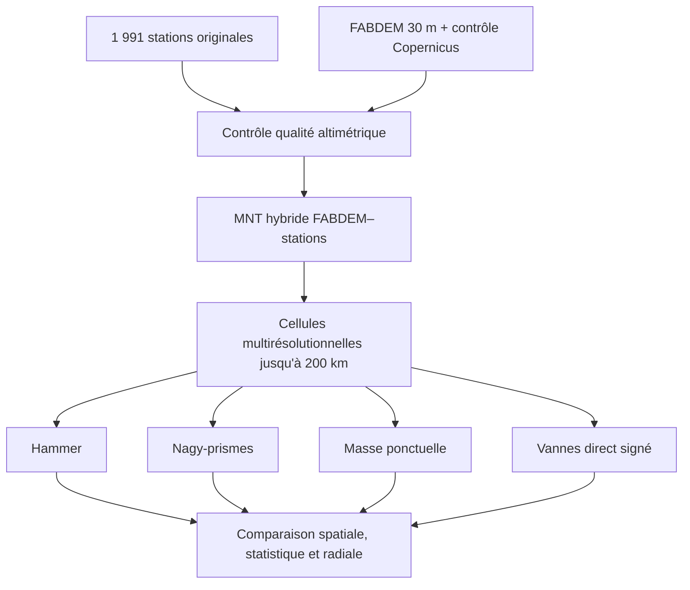
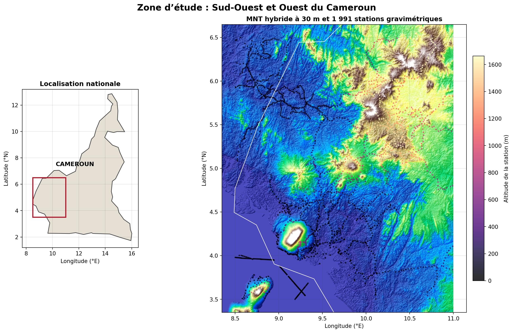
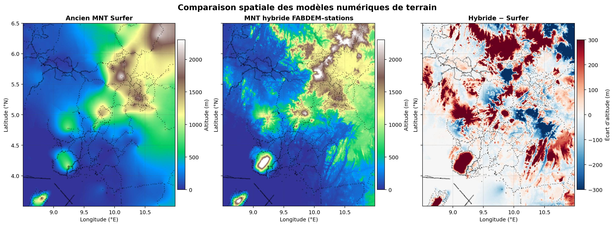
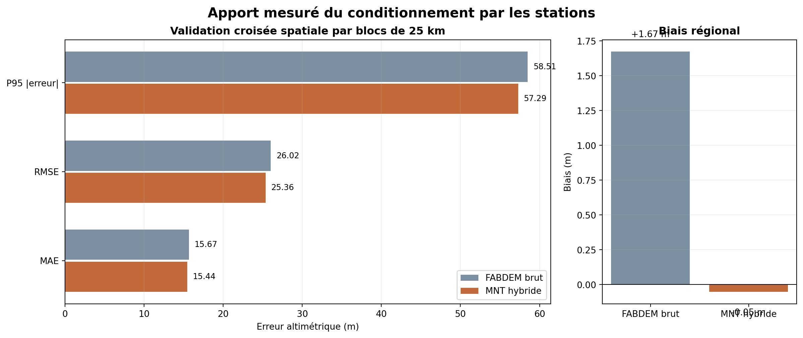
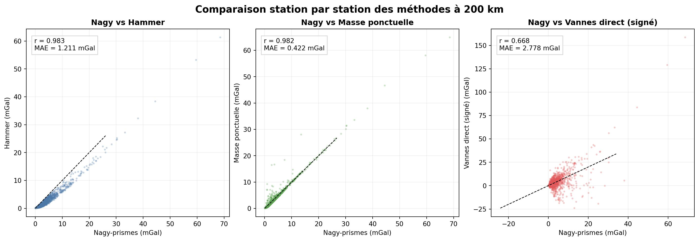
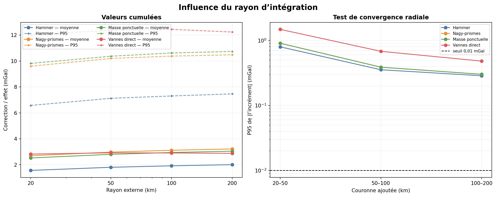
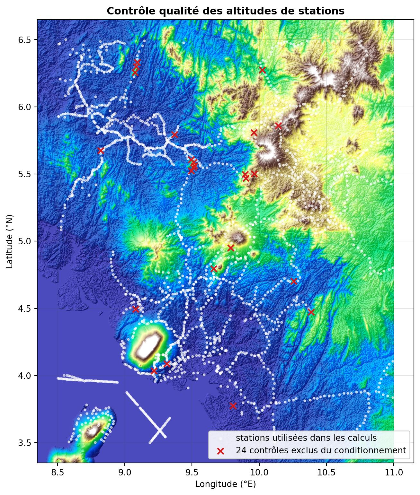

# Correction de relief des anomalies gravimétriques au Cameroun

Ce dépôt compare de manière reproductible plusieurs méthodes de calcul de l'effet
du relief pour les **1 991 stations originales** du fichier
`data/raw/original_stations.xlsx`. Le relief est représenté par un **MNT hybride
FABDEM-stations**, et non par la grille Surfer antérieure.

## Principe scientifique

Le projet sépare explicitement :

1. l'incertitude liée au modèle topographique ;
2. l'incertitude liée à la géométrie et à la méthode de calcul.

Toutes les méthodes utilisent donc les mêmes stations, la même densité de
2 670 kg/m3, le même MNT, les mêmes rayons et les mêmes cellules
multirésolutionnelles.

| Résultat | Interprétation |
|---|---|
| `nagy_prism_mgal` | correction classique positive, prismes rectangulaires exacts |
| `hammer_mgal` | approximation par compartiments annulaires-sectoriels |
| `point_mass_mgal` | approximation par masses ponctuelles, utilisée comme contrôle |
| `vannes_direct_mgal` | effet direct résiduel sphérique signé selon Vannes |

La valeur de Vannes n'est pas assimilée artificiellement à la correction
classique, car sa définition physique et son signe sont différents.

## Justification du MNT hybride

`out1.dat` a été krigé à partir des mêmes altitudes que celles utilisées pour le
contrôler. Sa faible erreur aux stations n'est donc pas une validation
indépendante. Sa maille d'environ 0,5 km lisse aussi le relief local.

Le modèle hybride conserve la morphologie FABDEM à 30 m et ajoute une correction
résiduelle robuste et lente :

```text
h_hybride(x,y) = h_FABDEM(x,y) + w(x,y) r_estime(x,y)
```

La construction complète, les 24 contrôles uniques exclus, les seuils et la
validation croisée par blocs de 25 km sont détaillés dans
[`docs/hybrid_dem_method.md`](docs/hybrid_dem_method.md). Le biais passe de
+1,673 m à -0,052 m et le RMSE spatial de 26,018 m à 25,360 m.

## Schéma du traitement et de la comparaison



## Cartes et graphiques principaux

### Zone d'étude, relief hybride et stations



La carte de gauche situe l'emprise dans le Cameroun. La carte détaillée montre
le relief du MNT hybride à 30 m et la distribution des 1 991 stations.

### Ancien MNT Surfer, MNT hybride et différence spatiale



Le panneau des différences met directement en évidence les crêtes, vallées et
volcans lissés par l'ancienne interpolation Surfer.

### Validation indépendante du MNT hybride



### Comparaison des méthodes à 200 km



### Convergence avec le rayon d'intégration



### Localisation des contrôles altimétriques exclus



L'[atlas commenté](docs/visual_results.md) explique ce que chaque figure permet
de conclure. Toutes ces images sont régénérées par
`scripts/make_visual_atlas.py`.

## Résultats à 200 km

| Méthode | Moyenne | Médiane | P95 | Maximum |
|---|---:|---:|---:|---:|
| Hammer-style | 2,006 | 0,864 | 7,463 | 61,328 |
| Nagy-prismes | 3,217 | 1,906 | 10,478 | 68,556 |
| Masse ponctuelle | 3,045 | 1,532 | 10,738 | 64,931 |
| Vannes direct | 2,880 | 1,306 | 12,235 | 158,643 |

Entre 100 et 200 km, le 95e percentile de l'incrément Nagy reste égal à
0,302 mGal. Le critère de convergence de 0,01 mGal n'est satisfait que par
environ 1 % des stations. Les résultats à 200 km sont donc les résultats de plus
grande extension disponibles, mais ils ne doivent pas être décrits comme une
limite infinie convergée.

## Exécution sous Windows 10 et Anaconda

```powershell
git clone https://github.com/ariel2000/terrain-correction-gravity.git
cd terrain-correction-gravity
conda create -n terrain-gravity python=3.12 -y
conda activate terrain-gravity
python -m pip install -e ".[dev]"
pytest
terrain-correction audit-stations data/raw/original_stations.xlsx
terrain-correction run --config config/default.toml
```

Les GeoTIFF volumineux ne sont pas enregistrés dans Git. Leur source et leur
emplacement attendu sont indiqués dans `data/external/README.md`. Les résultats
complets vérifiés sont conservés dans `outputs/reference/`.

## Limite principale

Les 26 lignes de stations associées aux 24 contrôles uniques exclus du
conditionnement du MNT restent calculées, mais sont signalées dans les résultats.
Les plus fortes corrections appartiennent à ce groupe. Leur altitude et leur
référentiel vertical doivent être vérifiés indépendamment avant toute
interprétation géologique.
